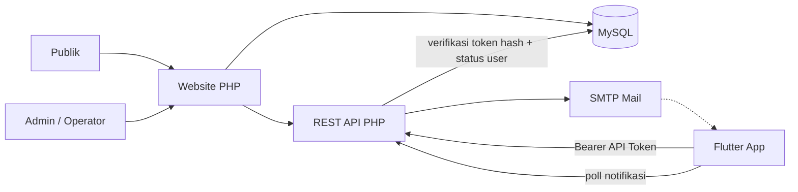

# D-01 Arsitektur Hybrid

## Tujuan

Menjelaskan hubungan website publik, admin web, REST API, MySQL, dan aplikasi Flutter setelah proyek diperluas ke akademik dan akreditasi, dengan sistem identitas sendiri tanpa penyedia identitas eksternal.

## Prinsip

1. **MySQL adalah sumber kebenaran** untuk data akademik, akreditasi, pengguna, konten, dan notifikasi.
2. **Tidak ada Firebase, penyedia autentikasi eksternal, atau layanan push pihak ketiga.** Autentikasi dan notifikasi in-app ditangani sendiri oleh backend PHP; email transaksional memakai SMTP dan tidak menyimpan data identitas.
3. **Satu sistem identitas:** web memakai session PHP, mobile memakai API token yang diterbitkan backend.
4. **Web dan mobile mengakses data yang sama lewat REST API.**
5. **Akun dibuat admin/operator**, bukan registrasi mandiri.
6. **File upload disimpan di luar `public/`** dan diakses lewat controller.
7. **Data pribadi siswa tidak pernah tampil di halaman publik.**
8. **Tidak ada kredensial, API key, atau service account penyedia eksternal** yang harus dikelola; hanya credential SMTP pada konfigurasi server.

## Diagram

Source: `DIAGRAM.md` (D-01).

## Komponen

| Komponen | Tanggung jawab |
|---|---|
| Website PHP | Halaman publik, CMS admin, modul akreditasi |
| REST API | Endpoint JSON untuk Flutter, verifikasi token |
| MySQL | Data pengguna, akademik, presensi guru, akreditasi, notifikasi |
| Session PHP | Login web admin dan panel akreditasi |
| API Token | Login aplikasi Flutter, revoke per perangkat |
| Flutter | Antarmuka siswa, guru, operator |
| Storage privat | File materi, tugas, bukti akreditasi |
| SMTP | Reset password dan pengumuman email |

## Alur data utama

1. Admin membuat akun di web.
2. Web menyimpan user di MySQL dengan role, status, dan hash password.
3. Pengguna login di aplikasi Flutter melalui `POST /api/v1/auth/login`.
4. Backend memverifikasi hash password, lalu menerbitkan API token dan menyimpan hash token di `api_tokens`.
5. Flutter menyimpan token di penyimpanan aman dan mengirim `Authorization: Bearer <token>`.
6. Backend memverifikasi hash token, masa berlaku, dan `is_active` user di MySQL, lalu mengembalikan data.
7. Notifikasi aplikasi diambil dari tabel `notifications`; push ke perangkat tidak dipakai.
8. Data akademik dan akreditasi selalu ditulis ke MySQL.

## Batasan

- Tidak ada push notification server-to-device pada v1; notifikasi memakai in-app center dan email.
- Tidak ada login sosial, OTP, atau multi-factor authentication.
- Tidak ada sinkronisasi akun, role, atau hash password ke penyedia identitas eksternal (Firebase Auth, Auth0, Supabase Auth, dan sejenisnya).
- Tidak ada aplikasi mobile terpisah untuk admin akreditasi pada v1.
- Tidak ada payment gateway, load test, atau pentest pihak ketiga pada fase ini.

## Konsekuensi teknis

- Token API harus acak (minimal 32 byte), disimpan sebagai hash di database, punya masa berlaku, dapat dirotasi, dan dapat dicabut.
- Password memakai `password_hash()`/`password_verify()` dengan `password_needs_rehash()`.
- Login web memakai session PHP dengan `session_regenerate_id()` dan cookie `HttpOnly`, `SameSite=Lax`, `Secure`.
- Penonaktifan akun di MySQL langsung berlaku karena API memeriksa `is_active` pada setiap request.
- Perubahan password atau logout mencabut token yang relevan dan mencatatnya di `activity_logs`.
- Reset password memakai token acak berumur 60 menit yang disimpan sebagai hash dan dikirim lewat SMTP.
- Notifikasi in-app dibaca dari tabel `notifications`; aplikasi melakukan polling ringan saat aktif.
