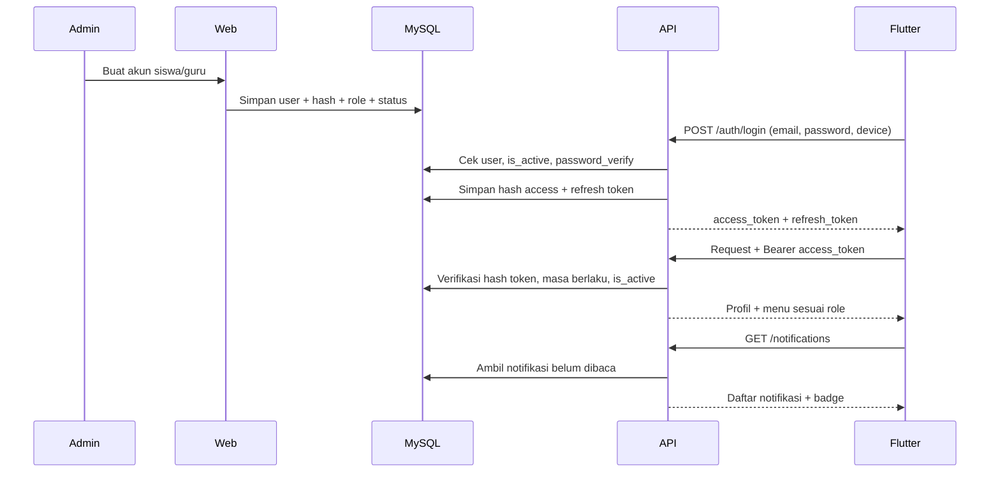

# D-02 Alur Autentikasi, Token API, dan Notifikasi

## Prinsip

- Tidak ada registrasi mandiri.
- Akun dibuat admin/operator.
- MySQL menyimpan kredensial (hash), role, status, dan penanda ganti password.
- Web memakai session PHP; mobile memakai API token yang diterbitkan backend.
- Tidak ada penyedia autentikasi eksternal (tanpa Firebase/Auth0/Supabase Auth).
- Role dan status selalu dibaca dari MySQL, tidak pernah dari body request.

## Model identitas

| Saluran | Mekanisme | Penyimpanan di klien |
|---|---|---|
| Web admin | Session PHP + CSRF token | Cookie `HttpOnly`, `SameSite=Lax` |
| Aplikasi Flutter | API token (bearer) | Penyimpanan aman perangkat (`flutter_secure_storage`) |

Satu akun, satu password: kredensial web dan mobile berasal dari tabel `users` yang sama.

## Alur pembuatan akun

1. Admin/operator membuka menu pengguna.
2. Admin mengisi nama, email, username, role, kelas (untuk siswa), dan mapel (untuk guru).
3. Sistem membuat password awal yang acak.
4. Web menyimpan data ke MySQL dengan `must_change_password = 1` dan `password_hash` (argon2id/bcrypt).
5. Kredensial disampaikan lewat email, WhatsApp, atau cetak.
6. Pengguna login dan wajib mengganti password saat pertama masuk.
7. Setiap pembuatan akun dicatat di `activity_logs`.

Tidak ada proses sinkronisasi ke layanan eksternal, sehingga tidak ada status `pending/synced` yang harus ditangani.

## Alur login aplikasi (mobile)

1. Pengguna memasukkan email/username dan password di Flutter.
2. Aplikasi mengirim `POST /api/v1/auth/login` (username/email, password, nama perangkat).
3. Backend mengambil user berdasarkan email/username, lalu memverifikasi password dengan `password_verify()`.
4. Backend memeriksa `is_active`, `locked_until`, dan `failed_login_attempts`.
5. Backend menerbitkan dua token acak (`random_bytes(32)`):
   - `access_token` berumur 30 menit untuk memakai API.
   - `refresh_token` berumur 30 hari untuk memperbarui sesi.
6. Backend menyimpan **hash** kedua token di `api_tokens` (SHA-256), bukan token aslinya.
7. Backend mengembalikan `access_token`, `refresh_token`, masa berlaku, dan profil singkat.
8. Aplikasi menyimpan token di penyimpanan aman perangkat.
9. Aplikasi memanggil `GET /api/v1/auth/me` dengan `Authorization: Bearer <access_token>`.
10. Backend memverifikasi hash token, masa berlaku, status pencabutan, dan `is_active` user.
11. Backend mengembalikan profil, role, dan menu sesuai role.
12. Jika `must_change_password = 1`, aplikasi mengarahkan ke halaman ganti password dan hanya mengizinkan endpoint ganti password.

### Refresh token

1. Aplikasi mengirim `POST /api/v1/auth/refresh` dengan `refresh_token`.
2. Backend memverifikasi hash, masa berlaku, dan status pencabutan.
3. Backend menerbitkan pasangan token baru dan mencabut token lama (rotasi).
4. Jika token lama dipakai lagi, backend mencabut seluruh token milik user tersebut (deteksi penyalahgunaan).

## Alur login web admin

1. Admin membuka `/admin/login`.
2. Web memvalidasi email/username dan password dari MySQL dengan `password_verify()`.
3. Session dibuat, `session_regenerate_id()` dipanggil, dan CSRF token disiapkan.
4. Role dicek pada setiap route admin.
5. Logout menghapus session dan mencatat aktivitas.

## Reset password

### Lewat email (SMTP)

1. Pengguna meminta reset dari halaman login atau aplikasi.
2. Backend membuat token reset acak berumur 60 menit dan menyimpan hash-nya di `password_resets`.
3. Email berisi tautan reset dikirim melalui SMTP.
4. Pengguna membuka tautan dan membuat password baru.
5. Password di-hash ulang, token dihapus (dipakai), dan seluruh API token user dicabut.

### Lewat admin

1. Admin membuka detail pengguna.
2. Admin menekan "Reset password".
3. Sistem membuat password sementara.
4. `must_change_password = 1` diaktifkan.
5. Password disampaikan ke pengguna.
6. Seluruh API token user dicabut agar perangkat lama harus login ulang.

## Ganti password

1. Pengguna memasukkan password lama dan password baru.
2. Backend memverifikasi password lama.
3. Password baru di-hash (`password_hash`), `must_change_password` direset ke `0`.
4. Seluruh API token lain dicabut; sesi web dirotasi.
5. Aktivitas tercatat di `activity_logs`.

## Penonaktifan dan pencabutan akses

1. Admin menonaktifkan akun di web.
2. MySQL menandai `is_active = 0`.
3. Backend mencabut seluruh `api_tokens` milik user tersebut.
4. API menolak setiap request user tersebut dengan HTTP 401, dan aplikasi mengarahkan ke halaman login.
5. Session web yang masih hidup diinvalidasi lewat pemeriksaan `is_active` pada setiap request.

## Notifikasi

Tidak ada push notification real-time (tanpa FCM/OneSignal). Notifikasi memakai dua kanal: in-app center di aplikasi dan email SMTP; SMTP hanya mengirim pesan dan tidak menyimpan data identitas pengguna.

### In-app center

1. Backend menulis notifikasi ke tabel `notifications` dengan `user_id`, judul, isi, dan tautan.
2. Aplikasi melakukan polling ringan `GET /api/v1/notifications` saat aktif (default 60 detik) dan menampilkan lonceng/badge belum dibaca.
3. Pengguna menandai notifikasi terbaca melalui `POST /api/v1/notifications/{id}/read`.

### Email

1. Email dipakai untuk reset password dan pengumuman penting.
2. Pengiriman memakai SMTP yang dikonfigurasi di `config/mail.php` (host, port, kredensial).
3. Kegagalan pengiriman tidak memblokir operasi utama; dicatat di log.

## Diagram

Source: `DIAGRAM.md` (D-02).

## Aturan keamanan

- Password disimpan dengan `password_hash()`; hash dicek dengan `password_verify()`.
- Token API dibuat dengan `random_bytes(32)`, disimpan sebagai hash SHA-256, dan tidak pernah ditulis ke log.
- Login dibatasi percobaan gagal dan diberi jeda (`failed_login_attempts`, `locked_until`).
- Token API memiliki masa berlaku; refresh token dirotasi setiap kali dipakai.
- API memakai HTTPS.
- Role tidak boleh dipercaya dari body request; selalu ambil dari MySQL setelah token diverifikasi.
- Endpoint admin/operator dicek role di middleware.
- Reset password token hanya bisa dipakai sekali dan langsung dihapus setelah dipakai.
- Semua token dicabut saat password diganti atau akun dinonaktifkan.
