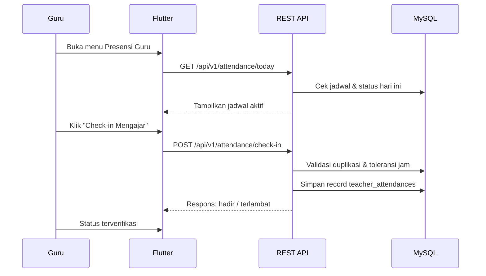

# D-03 Alur Presensi Kehadiran Guru

## Prinsip

- **Sistem presensi hanya mencatat kehadiran guru.**
- Modul presensi siswa dan kartu QR siswa ditiadakan demi simplifikasi dan efisiensi ruang lingkup (<1 bulan).
- Presensi guru berfungsi ganda:
  1. Bukti disiplin kerja harian pendidik.
  2. Bukti otentik keterlaksanaan pembelajaran untuk **Akreditasi IA2024** (nomor butir diverifikasi terhadap instrumen resmi).
- Guru melakukan presensi kehadiran melalui aplikasi Flutter (atau konfirmasi operator di web admin).

## Metode Presensi Guru

Guru dapat melakukan presensi melalui salah satu dari dua cara berikut:

1. **Presensi Jam Mengajar (Berdasarkan Jadwal):**
   - Guru membuka aplikasi Flutter MADRASAHKU.
   - Sistem menampilkan kartu jadwal mengajar hari ini.
   - Guru menekan tombol **"Presensi Masuk Mengajar"** saat jam pelajaran dimulai.
   - Sistem mencatat waktu server (*server timestamp*), membandingkan dengan jam mulai jadwal.
2. **Presensi Harian / Datang:**
   - Guru check-in kehadiran harian saat tiba di madrasah melalui tombol verifikasi di aplikasi mobile.
   - Operator dapat mencatat atau mengoreksi kehadiran guru melalui panel web jika guru tidak membawa perangkat.

## Alur Presensi Guru via Aplikasi Mobile

1. Guru login ke aplikasi Flutter.
2. Membuka menu **Presensi Guru**.
3. Sistem memanggil `GET /api/v1/attendance/today` untuk mengambil jadwal dan status presensi hari ini.
4. Guru menekan tombol **Check-in**.
5. Aplikasi mengirim `POST /api/v1/attendance/check-in` dengan header `Authorization: Bearer <API_Token>`.
6. API memvalidasi:
   - Pengguna ber-role `guru`.
   - Guru belum melakukan check-in pada sesi/jadwal tersebut hari ini (mencegah duplikasi).
   - Waktu request berada dalam rentang toleransi jadwal.
7. API menyimpan data ke tabel `teacher_attendances`.
8. API mengembalikan status presensi (`hadir` atau `terlambat`).
9. Guru melihat status kehadiran terkonfirmasi.

## Status Presensi Guru

| Status | Keterangan |
|---|---|
| `hadir` | Check-in tepat waktu sesuai jadwal/jam masuk |
| `terlambat` | Check-in melewati batas toleransi keterlambatan (misal > 15 menit) |
| `izin` | Dicatat operator/kepala dengan keterangan resmi |
| `sakit` | Sakit dengan surat keterangan dokter / pemberitahuan |
| `dinas_luar` | Menghadiri tugas luar, MGMP, pelatihan Kemenag, atau dinas dinas |
| `alpha` | Tidak melakukan check-in tanpa keterangan hingga jam berakhir |

## Validasi & Keamanan Presensi

- **Pencegahan Duplikasi:** Setiap guru hanya dapat memiliki satu record presensi per tanggal (presensi harian) atau per jadwal mengajar pada tanggal yang sama.
- **Waktu Server:** Waktu presensi selalu ditentukan oleh jam server MySQL/PHP, bukan jam lokal smartphone guru (mencegah manipulasi jam perangkat).
- **Koreksi Manual:** Kepala Madrasah dan Operator dapat mengubah status (misal dari alpha ke dinas_luar/izin). Setiap koreksi dicatat di `activity_logs`.
- **Role Guard:** Siswa dilarang keras mengakses endpoint presensi ini (HTTP 403 Forbidden).

## Diagram Alur

Source: `DIAGRAM.md` (D-03).

## Rekapitulasi & Pelaporan untuk Akreditasi IA2024

- **Panel Admin Web:** Kepala Madrasah dan Operator dapat melihat rekapitulasi kehadiran seluruh guru secara bulanan dan semesteran.
- **Ekspor Dokumen:** Rekapitulasi dapat diekspor ke Excel dan PDF (*Daftar Hadir Guru Mengajar*) lengkap dengan kolom persentase kehadiran dan tanda tangan Kepala Madrasah.
- **Pusat Kendali Akreditasi:** Rekap presensi guru dapat ditautkan (*mapped*) ke butir terkait kinerja pendidik dan tata kelola madrasah, misalnya:
  - **Komponen 1:** Kinerja Pendidik dalam mengelola pembelajaran terencana dan disiplin waktu mengajar.
  - **Komponen 2:** Disiplin kerja dan kehadiran guru sebagai bagian tata kelola kepemimpinan kepala madrasah.

Catatan: nomor butir pasti harus diverifikasi terhadap instrumen IA2024 terbaru sebelum pemetaan dilakukan.
