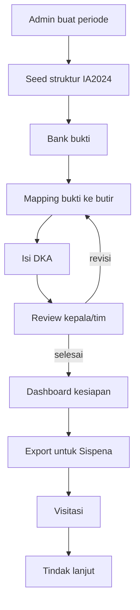

# D-04 Alur Akreditasi

## Tujuan

Menyediakan pusat kendali akreditasi berbasis IA2024: bank bukti, pemetaan ke butir, DKA, analisis kesiapan, dan ekspor.

Aplikasi **tidak menggantikan Sispena**. Aplikasi menyiapkan data dan bukti, lalu tim mengunggahnya ke Sispena.

## Struktur IA2024

| Komponen | Butir | Indikator |
|---|---:|---:|
| Kinerja Pendidik dalam Pembelajaran | 4 | 19 |
| Kepemimpinan Kepala Madrasah | 5 | 21 |
| Iklim Lingkungan Belajar | 5 | 19 |
| Kompetensi dan Hasil Pembelajaran | — | Data AN/Rapor Pendidikan |
| **Total komponen 1–3** | **14** | **59** |

Catatan: jumlah dan rumusan butir mengikuti instrumen resmi yang berlaku. Seed awal harus diverifikasi dengan dokumen IA2024 terbaru sebelum dipakai.

## Dokumen utama

- KSP
- RKT
- RKAS
- Kalender akademik
- Contoh RPP
- Foto/video lingkungan belajar
- Dokumen pendukung lain

## Peran

| Peran | Hak |
|---|---|
| Admin | Semua akses, konfigurasi periode, hapus data |
| Operator | Input data, unggah bukti, kelola pengguna |
| Kepala Madrasah | Review, approve, lihat dashboard |
| Tim Akreditasi | Kelola bukti, mapping butir, isi DKA |
| Guru | Unggah bukti yang ditugaskan |

## Alur kerja

1. Admin membuat periode akreditasi dan menetapkan tahun ajaran.
2. Sistem menyalin struktur IA2024 ke periode tersebut.
3. Tim akreditasi mengunggah bukti ke bank bukti.
4. Setiap bukti dipetakan ke satu atau lebih butir/indikator.
5. Tim mengisi DKA untuk setiap butir (maksimal 1.000 karakter).
6. Kepala madrasah mereview dan memberi status.
7. Dashboard menampilkan gap: butir tanpa bukti, bukti kedaluwarsa, DKA kosong, tugas terlambat.
8. Tim memperbaiki gap.
9. Sistem mengekspor ringkasan dan daftar bukti untuk diunggah ke Sispena.
10. Hasil visitasi dan rekomendasi dicatat sebagai tindak lanjut.

## Status butir

| Status | Arti |
|---|---|
| `belum` | Belum ada bukti/DKA |
| `draft` | Sedang diisi |
| `review` | Menunggu review kepala/tim |
| `revisi` | Perlu perbaikan |
| `selesai` | Sudah disetujui |
| `tidak_berlaku` | Tidak relevan, dengan alasan |

## Status bukti

- `aktif`
- `kedaluwarsa`
- `arsip`
- `ditolak`

## Rumus kesiapan

Kesiapan dihitung per butir, lalu dirata-rata:

```
skor_butir = (bobot_bukti + bobot_dka + bobot_review) / 3
```

Contoh bobot:

- bukti valid = 1, tidak ada = 0
- DKA terisi = 1, kosong = 0
- review selesai = 1, belum = 0

Angka ini hanya indikator internal, bukan skor resmi akreditasi.

## Ekspor

- Ringkasan per komponen/butir (CSV/Excel).
- Daftar bukti per butir dengan tautan file.
- DKA per butir (DOCX/PDF).
- Paket dokumen utama.
- Laporan gap dan tindak lanjut.

## Diagram



Source: `DIAGRAM.md` (D-04).

## Aturan data

- Bukti menyimpan `uploaded_by`, `verified_by`, `valid_until`, dan `checksum`.
- Satu bukti boleh dipetakan ke beberapa butir.
- Menghapus bukti harus soft delete dan tercatat di `activity_logs`.
- DKA menyimpan versi; perubahan setelah review harus membuat versi baru.
- File bukti disimpan di storage privat, bukan `public/uploads`.
