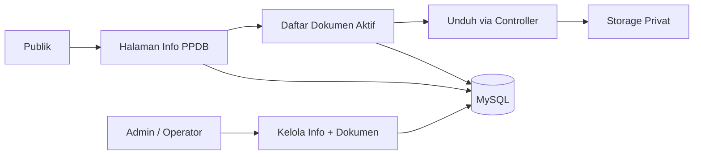

# D-05 Informasi dan Dokumen PPDB

## Tujuan

Menyediakan halaman PPDB **tanpa formulir pendaftaran**. Halaman hanya berisi informasi resmi dan dokumen yang dapat diunduh. Pendaftaran tetap dilakukan secara manual/offline sesuai kebijakan madrasah.

## Cakupan v1

- Halaman informasi PPDB.
- Jadwal penting.
- Syarat pendaftaran.
- Alur pendaftaran manual.
- Daftar dokumen unduhan.
- Kontak panitia.
- Admin mengelola informasi dan dokumen.

Di luar cakupan:

- Formulir pendaftaran online.
- Verifikasi pendaftar.
- Cek status pendaftaran.
- Pembayaran online.
- Upload dokumen oleh calon siswa.

## Struktur halaman publik `/ppdb`

1. **Hero**: judul PPDB dan tahun ajaran.
2. **Jadwal**: tanggal buka, tutup, seleksi, pengumuman.
3. **Syarat**: daftar persyaratan.
4. **Alur**: langkah pendaftaran manual.
5. **Dokumen unduhan**: daftar file yang bisa diunduh.
6. **Kontak panitia**: telepon, WhatsApp, email, alamat.
7. **Informasi tambahan**: tautan ke berita/pengumuman terkait.

Tidak ada tombol “Daftar Sekarang” yang membuka form. Tombol yang disediakan adalah “Unduh Dokumen” dan “Hubungi Panitia”.

## Dokumen yang disediakan

| Dokumen | Contoh format | Pengelola |
|---|---|---|
| Brosur PPDB | PDF | Operator |
| Surat edaran PPDB | PDF | Operator |
| Syarat pendaftaran | PDF | Operator |
| Formulir pendaftaran manual | PDF/DOCX | Operator |
| Panduan pengisian formulir | PDF | Operator |
| Kalender/jadwal PPDB | PDF | Operator |

Setiap dokumen memiliki:

- judul,
- deskripsi singkat,
- tipe file,
- ukuran,
- urutan tampil,
- status aktif/nonaktif.

## Alur publik

1. Publik membuka `/ppdb`.
2. Publik membaca informasi dan jadwal.
3. Publik melihat daftar dokumen aktif.
4. Publik mengunduh dokumen yang dibutuhkan.
5. Publik menghubungi panitia jika ada pertanyaan.

Tidak ada data pribadi yang dikumpulkan dari halaman ini.

## Alur admin

1. Admin/operator login ke `/admin`.
2. Buka `/admin/ppdb`.
3. Edit informasi PPDB: jadwal, syarat, alur, kontak.
4. Upload dokumen baru atau ganti dokumen lama.
5. Atur urutan dan status aktif dokumen.
6. Nonaktifkan/arsipkan dokumen yang tidak berlaku.
7. Perubahan tercatat di `activity_logs`.

## Data

| Tabel | Fungsi |
|---|---|
| `pages` | Menyimpan konten informasi PPDB dengan slug `ppdb` |
| `ppdb_documents` | Metadata dokumen unduhan |
| `media` | Metadata file umum |
| `activity_logs` | Audit perubahan |

Kolom `ppdb_documents`:

- `id`
- `title`
- `description`
- `file_path`
- `file_type`
- `file_size`
- `sort_order`
- `is_active`
- `download_count` (opsional)
- `uploaded_by`
- `created_at`
- `updated_at`

## Penyimpanan file

- File disimpan di `storage/ppdb/`, bukan di `public/`.
- Unduhan melewati controller `/ppdb/dokumen/{id}`.
- Controller mengecek status aktif dan mengirim header download.
- Nama file fisik dibuat acak.
- File lama diarsipkan, tidak langsung dihapus.

## Keamanan

- Hanya admin/operator yang bisa upload.
- Validasi ekstensi dan MIME.
- Batas ukuran file.
- Sanitasi judul dan deskripsi.
- Cegah path traversal.
- Tolak dokumen nonaktif atau tidak ditemukan dengan 404.
- Jangan tampilkan path fisik file.
- Catat aktivitas upload/ganti/hapus.

## Diagram

Source: `DIAGRAM.md` (D-05).

## Kaitan dengan akreditasi

Dokumen PPDB dapat menjadi bukti pendukung untuk indikator yang relevan, misalnya sosialisasi penerimaan siswa dan keterlibatan masyarakat. Tim akreditasi tetap memilih dan memetakan bukti secara manual.

## Acceptance criteria

- Halaman `/ppdb` menampilkan informasi dari database.
- Hanya dokumen aktif yang tampil.
- Dokumen dapat diunduh dengan benar.
- Dokumen nonaktif/tidak ditemukan menghasilkan 404.
- Admin dapat mengubah informasi dan mengganti dokumen.
- Tidak ada form pendaftaran di halaman PPDB.
- Halaman responsif dan dapat diakses.
