# D-06 ERD

## Prinsip

- Nama tabel dan kolom memakai `snake_case`.
- Semua tabel transaksi memiliki `created_at` dan `updated_at`.
- Penghapusan data penting memakai soft delete (`deleted_at`).
- Relasi memakai foreign key dan index.
- File disimpan sebagai metadata; isi file ada di storage privat.

## Diagram

```mermaid
erDiagram
    USERS ||--o| STUDENTS : "profil siswa"
    USERS ||--o| TEACHERS : "profil guru"
    USERS ||--o{ ACTIVITY_LOGS : "aktivitas"
    USERS ||--o{ API_TOKENS : "token"
    USERS ||--o{ NOTIFICATIONS : "notifikasi"
    USERS ||--o{ PASSWORD_RESETS : "reset"

    ACADEMIC_YEARS ||--o{ CLASSES : "tahun ajaran"
    CLASSES ||--o{ STUDENTS : "anggota"
    CLASSES ||--o{ SCHEDULES : "jadwal"
    SUBJECTS ||--o{ SCHEDULES : "mapel"
    TEACHERS ||--o{ SCHEDULES : "guru"
    CLASSES ||--o{ CLASS_SUBJECTS : "kelas-mapel"
    SUBJECTS ||--o{ CLASS_SUBJECTS : "kelas-mapel"
    TEACHERS ||--o{ CLASS_SUBJECTS : "pengampu"

    CLASS_SUBJECTS ||--o{ MATERIALS : "materi"
    CLASS_SUBJECTS ||--o{ ASSIGNMENTS : "tugas"
    ASSIGNMENTS ||--o{ SUBMISSIONS : "pengumpulan"
    STUDENTS ||--o{ SUBMISSIONS : "mengumpulkan"
    TEACHERS ||--o{ SUBMISSIONS : "menilai"

    TEACHERS ||--o{ TEACHER_ATTENDANCES : "presensi"
    SCHEDULES |o--o{ TEACHER_ATTENDANCES : "jadwal mengajar"

    ACCREDITATION_PERIODS ||--o{ ACCREDITATION_COMPONENTS : "komponen"
    ACCREDITATION_COMPONENTS ||--o{ ACCREDITATION_BUTIRS : "butir"
    ACCREDITATION_BUTIRS ||--o{ ACCREDITATION_INDICATORS : "indikator"
    ACCREDITATION_BUTIRS ||--o{ DKA_ENTRIES : "DKA"
    EVIDENCE ||--o{ EVIDENCE_BUTIR : "mapping"
    ACCREDITATION_BUTIRS ||--o{ EVIDENCE_BUTIR : "bukti"
    ACCREDITATION_BUTIRS ||--o{ INDICATOR_CHECKS : "pemeriksaan"
    ACCREDITATION_INDICATORS ||--o{ INDICATOR_CHECKS : "pemeriksaan"
    ACCREDITATION_PERIODS ||--o{ EVIDENCE : "bukti"
    USERS ||--o{ EVIDENCE : "mengunggah"
    USERS ||--o{ DKA_ENTRIES : "mengisi"
    USERS ||--o{ MAIN_DOCUMENTS : "mengunggah"
    USERS ||--o{ TASKS : "ditugaskan"
    USERS ||--o{ ACCREDITATION_RESULTS : "mencatat"
    ACCREDITATION_PERIODS ||--o{ MAIN_DOCUMENTS : "dokumen utama"
    ACCREDITATION_PERIODS ||--o{ TASKS : "tugas"
    ACCREDITATION_PERIODS ||--o{ ACCREDITATION_RESULTS : "hasil"
    ACCREDITATION_RESULTS ||--o{ FOLLOW_UPS : "tindak lanjut"

    USERS {
        bigint id PK
        string name
        string email UK
        string username UK
        string password_hash
        string role
        boolean is_active
        boolean must_change_password
        datetime last_login_at
    }

    STUDENTS {
        bigint id PK
        bigint user_id FK
        string nis
        string nisn
        string gender
        date birth_date
        bigint class_id FK
        boolean is_active
    }

    TEACHERS {
        bigint id PK
        bigint user_id FK
        string nip
        string phone
        boolean is_active
    }

    ACADEMIC_YEARS {
        bigint id PK
        string name
        date start_date
        date end_date
        boolean is_active
    }

    CLASSES {
        bigint id PK
        string name
        string level
        bigint academic_year_id FK
        bigint homeroom_teacher_id FK
    }

    SUBJECTS {
        bigint id PK
        string code UK
        string name
    }

    CLASS_SUBJECTS {
        bigint id PK
        bigint class_id FK
        bigint subject_id FK
        bigint teacher_id FK
    }

    SCHEDULES {
        bigint id PK
        bigint class_subject_id FK
        tinyint day_of_week
        time start_time
        time end_time
        string room
    }

    MATERIALS {
        bigint id PK
        bigint class_subject_id FK
        string title
        text description
        string file_path
        datetime published_at
    }

    ASSIGNMENTS {
        bigint id PK
        bigint class_subject_id FK
        string title
        text description
        datetime due_at
        decimal max_score
    }

    SUBMISSIONS {
        bigint id PK
        bigint assignment_id FK
        bigint student_id FK
        string file_path
        text note
        decimal score
        text feedback
        datetime submitted_at
        datetime graded_at
        bigint graded_by FK
    }

    TEACHER_ATTENDANCES {
        bigint id PK
        bigint teacher_id FK
        bigint schedule_id FK
        date attendance_date
        string attendance_type
        datetime check_in_at
        datetime check_out_at
        string status
        string note
        bigint verified_by FK
    }

    EVIDENCE {
        bigint id PK
        bigint period_id FK
        string title
        string file_path
        string mime_type
        bigint file_size
        string checksum
        date valid_until
        string status
        bigint uploaded_by FK
        bigint verified_by FK
    }

    EVIDENCE_BUTIR {
        bigint id PK
        bigint evidence_id FK
        bigint butir_id FK
    }

    DKA_ENTRIES {
        bigint id PK
        bigint butir_id FK
        text content
        int version
        string status
        bigint updated_by FK
    }

    INDICATOR_CHECKS {
        bigint id PK
        bigint butir_id FK
        bigint indicator_id FK
        string status
        text note
    }

    ACCREDITATION_PERIODS {
        bigint id PK
        string name
        date start_date
        date end_date
        string status
        boolean is_active
    }

    ACCREDITATION_COMPONENTS {
        bigint id PK
        bigint period_id FK
        int number
        string name
    }

    ACCREDITATION_BUTIRS {
        bigint id PK
        bigint component_id FK
        int number
        text text
        string status
    }

    ACCREDITATION_INDICATORS {
        bigint id PK
        bigint butir_id FK
        int number
        text text
    }

    MAIN_DOCUMENTS {
        bigint id PK
        bigint period_id FK
        string type
        string title
        string file_path
        string status
    }

    TASKS {
        bigint id PK
        bigint period_id FK
        string title
        bigint assigned_to FK
        date due_date
        string status
    }

    ACCREDITATION_RESULTS {
        bigint id PK
        bigint period_id FK
        string grade
        decimal score
        text notes
        date decided_at
    }

    FOLLOW_UPS {
        bigint id PK
        bigint result_id FK
        text recommendation
        string status
        date due_date
    }

    ACTIVITY_LOGS {
        bigint id PK
        bigint user_id FK
        string action
        string entity
        bigint entity_id
        text metadata
        datetime created_at
    }

    API_TOKENS {
        bigint id PK
        bigint user_id FK
        string access_token_hash UK
        string refresh_token_hash UK
        string device_name
        string platform
        string ip_address
        datetime expires_at
        datetime refresh_expires_at
        datetime last_used_at
        datetime revoked_at
    }

    NOTIFICATIONS {
        bigint id PK
        bigint user_id FK
        string title
        text body
        string link
        string type
        boolean is_read
        datetime read_at
        datetime created_at
    }

    PASSWORD_RESETS {
        bigint id PK
        bigint user_id FK
        string token_hash
        datetime expires_at
        datetime used_at
    }
```

## Catatan tabel

| Kelompok | Tabel |
|---|---|
| Identitas | `users`, `students`, `teachers`, `api_tokens`, `password_resets` |
| Notifikasi | `notifications` |
| Akademik | `academic_years`, `classes`, `subjects`, `class_subjects`, `schedules` |
| Pembelajaran | `materials`, `assignments`, `submissions` |
| Presensi | `teacher_attendances` |
| Akreditasi | `accreditation_periods`, `accreditation_components`, `accreditation_butirs`, `accreditation_indicators`, `evidence`, `evidence_butir`, `dka_entries`, `indicator_checks`, `main_documents`, `tasks`, `accreditation_results`, `follow_ups` |
| Sistem | `activity_logs` |

## Index dan constraint penting

- `users.email`, `users.username` unik.
- `students.nis` unik.
- `class_subjects(class_id, subject_id, teacher_id)` unik.
- `teacher_attendances(teacher_id, attendance_date, attendance_type, schedule_id)` unik; `schedule_id` NULL untuk presensi harian.
- `api_tokens.access_token_hash`, `api_tokens.refresh_token_hash` unik.
- `evidence_butir(evidence_id, butir_id)` unik.
- Index pada `api_tokens.user_id`, `api_tokens.expires_at`, `notifications(user_id, is_read)`, `submissions.student_id`, `evidence.period_id`, `tasks.assigned_to`.
- Foreign key memakai `ON DELETE RESTRICT` untuk data akademik dan `ON DELETE CASCADE` hanya untuk tabel anak yang aman.

## Urutan migrasi yang disarankan

1. `users`
2. `students`, `teachers`
3. `academic_years`, `classes`, `subjects`, `class_subjects`, `schedules`
4. `materials`, `assignments`, `submissions`
5. `teacher_attendances`
6. `accreditation_periods` dan struktur instrumen
7. `evidence`, `evidence_butir`, `dka_entries`, `indicator_checks`
8. `main_documents`, `tasks`, `accreditation_results`, `follow_ups`
9. `activity_logs`, `api_tokens`, `notifications`, `password_resets`

Source: `DIAGRAM.md` (D-06).

## Tabel CMS

Tabel untuk berita, halaman, galeri, fasilitas, menu, pengaturan, PPDB info + dokumen, kontak, dan media dibahas di `10-perombakan-web.md` karena termasuk kebutuhan khusus web, bukan inti akademik/akreditasi.
