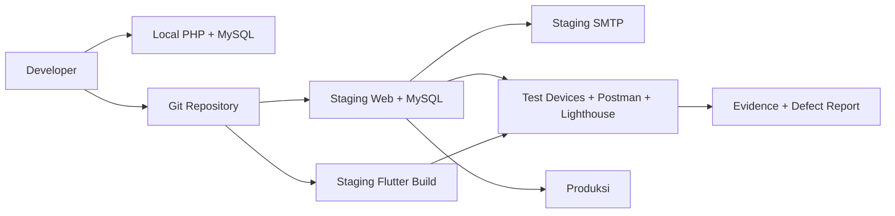
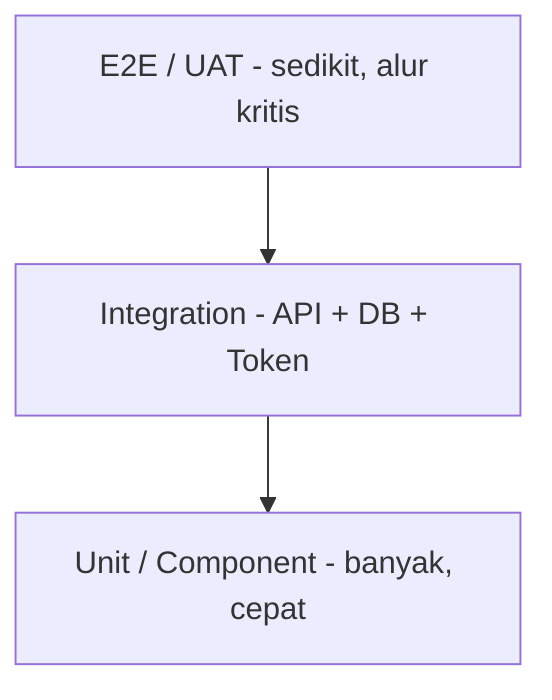
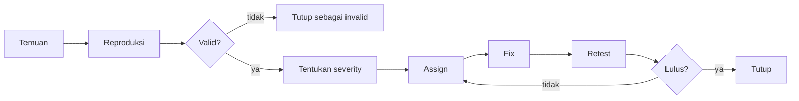
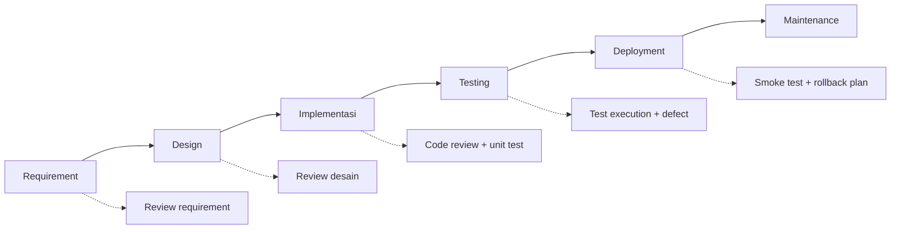
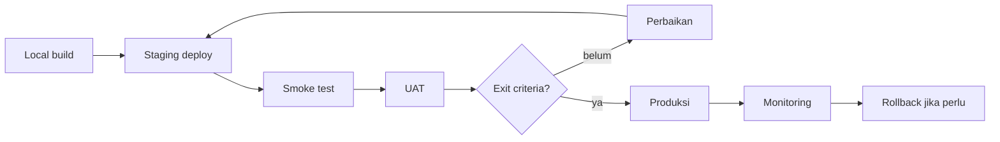

# Lingkungan dan Strategi SQA

## Lingkungan

| Lingkungan | Kegunaan | Data | Konfigurasi |
|---|---|---|---|
| Lokal | Development dan unit/integration test | Seed/dummy | `.env` lokal, SMTP uji |
| Staging | UAT, regression, demo | Mirip produksi, tanpa data sensitif asli | `.env` staging, SMTP staging |
| Produksi | Operasional | Data asli | `.env` produksi, SMTP madrasah |

Aturan:

- Staging memakai database terpisah dari produksi.
- Kredensial tidak disimpan di repo.
- Data siswa di staging dianonimkan.
- Pengujian yang mengubah data dilakukan di lokal/staging, bukan produksi.

## D-08 Topologi lingkungan uji

Source: `DIAGRAM.md` (D-08).

## D-09 Piramida pengujian

Komposisi target:

| Level | Porsi | Contoh |
|---|---:|---|
| Unit/component | 40% | Validasi form, helper, perhitungan kesiapan |
| Integration | 35% | API + MySQL, auth token, upload, check-in presensi guru |
| E2E/UAT | 25% | Login, presensi guru, PPDB info/dokumen, akreditasi |

Source: `DIAGRAM.md` (D-09).

## D-10 Alur bug triage

Severity:

| Severity | Kriteria | Target |
|---|---|---|
| Critical | Tidak bisa login, data hilang, kebocoran akses | Fix segera |
| High | Fitur utama gagal, workaround sulit | Sebelum UAT |
| Medium | Fitur berjalan tapi ada kesalahan | Sprint berjalan |
| Low | Kosmetik/teks | Jika ada waktu |

Source: `DIAGRAM.md` (D-10).

## D-11 SDLC dan QA

Source: `DIAGRAM.md` (D-11).

## D-12 Deployment dan go-live

Source: `DIAGRAM.md` (D-12).

## Jenis pengujian

- **Functional**: form, CRUD, validasi, navigasi.
- **Integration**: API–MySQL, token API, upload, check-in presensi guru.
- **Role/security**: akses antar-role, IDOR, CSRF, XSS, file traversal.
- **Regression**: fitur lama tetap berjalan.
- **UAT**: skenario nyata oleh guru/operator/kepala.
- **Performance ringan**: Lighthouse, waktu respons API.
- **Accessibility**: label form, kontras, navigasi keyboard.
- **Compatibility**: Chrome/Edge/Firefox, Android/iOS target.

## Data uji

- 1 admin, 2 operator, 2 kepala, 5 guru, 30 siswa, 3 kelas, 5 mapel.
- 1 periode akreditasi dengan 14 butir.
- Bukti contoh: PDF, JPG, DOCX dengan ukuran valid dan melebihi batas.
- Dokumen PPDB: file valid, file rusak, tipe tidak diizinkan, ukuran melebihi batas, dokumen nonaktif.
- Presensi guru: tepat waktu, terlambat, duplikat, di luar jadwal, role siswa ditolak.
- Token API: access token valid/kedaluwarsa, refresh token rotasi, token dicabut, akun dinonaktifkan, login gagal berulang.
- Notifikasi: notifikasi masuk ke `notifications`, tampil di aplikasi, ditandai terbaca, email reset password terkirim dan tokennya hanya berlaku sekali.

## Tools

- PHPUnit atau skrip uji PHP sederhana.
- Postman/Newman untuk API.
- Lighthouse untuk performa/accessibility.
- Flutter test/integration_test.
- Spreadsheet untuk RTM dan defect log.
- Mermaid untuk diagram; ekspor PNG/SVG untuk laporan.

## Exit criteria

- Tidak ada defect Critical/High terbuka.
- Pass rate minimal 95%.
- Semua alur kritis lulus: login (web + API token), presensi guru, PPDB info/dokumen, akreditasi, ekspor.
- Tidak ada akses lintas role.
- Smoke test produksi lulus.
- Bukti eksekusi dan laporan tersimpan.
