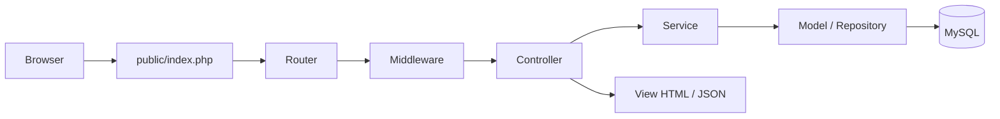

# Perombakan Web MTs Al-Huda

Dokumen khusus **web** untuk brainstorming di platform lain. Fokus: website publik, admin web, dan REST API. Aplikasi Flutter hanya disebut sebagai konsumen API.

Status: **blueprint v0.1 — 2026-10-21**  
Belum ada kode yang diubah.

---

## 1. Ringkasan

Website saat ini adalah landing page statis dengan beberapa halaman publik. Targetnya menjadi:

1. **Website publik** yang kontennya dikelola dari admin.
2. **Admin web** untuk pengguna, akademik, informasi/dokumen PPDB, presensi guru, dan akreditasi.
3. **REST API** untuk aplikasi Flutter.
4. **Pusat kendali akreditasi** berbasis IA2024.

Web tetap memakai **PHP MVC + MySQL/PDO**. Tidak pindah framework. Mobile tetap Flutter dan memakai autentikasi token dari backend PHP sendiri (tanpa Firebase/penyedia identitas eksternal).

---

## 2. Audit kondisi saat ini

| Area | Kondisi | Bukti |
|---|---|---|
| Router | Hanya GET publik, belum ada admin/API | `public/index.php:24-45` |
| Route berita | Detail memakai segmen URL, belum validasi slug | `public/index.php:36-39` |
| Helper | `base_url`, `current_route`, `asset` sudah ada | `app/helpers.php:23-66` |
| Database | File config kosong | `config/database.php` 0 byte |
| Model | Semua model kosong | `app/Models/*` 0 byte |
| Admin controller | Semua kosong | `AdminController`, `AuthController`, `Admin*Controller`, `MenuController` 0 byte |
| Admin view | Semua kosong | `app/Views/admin/*` 0 byte |
| Halaman publik | Sudah ada tampilan | `app/Views/{home,profil,akademik,fasilitas,galeri,berita,kontak,ppdb}` |
| Berita | Data hardcoded di view | `app/Views/berita/index.php:5-24` |
| PPDB | Hanya informasi statis; belum dikelola admin dan belum ada dokumen unduhan | `app/Views/ppdb/index.php` |
| Kontak | Hanya info alamat/telepon/email, belum ada form | `app/Views/kontak/index.php` |
| Aset | CSS/JS/gambar sudah ada | `public/css/style.css`, `public/js/script.js` |
| Desain | Variabel warna hijau dan font Plus Jakarta Sans | `public/css/style.css:1-15` |
| JS | Hanya toggle menu mobile | `public/js/script.js` |
| Rewrite | Aset diarahkan ke `public/` | `.htaccess:4-7` |
| Pengujian | Belum ada test | Tidak ditemukan |
| Encoding | Beberapa ikon di beranda tampak rusak (mojibake) | `app/Views/home/index.php` |

### Kesimpulan audit

- **Frontend publik sudah ada**, tetapi masih statis.
- **Backend, admin, database, dan API belum ada.**
- **PPDB masih statis dan belum punya dokumen unduhan; kontak belum menangkap data.**
- **Belum ada autentikasi, role, validasi, CSRF, atau audit log.**
- **Belum ada modul akademik, presensi guru, dan akreditasi.**

---

## 3. Masalah utama yang harus diselesaikan

1. Konten publik tidak bisa diubah tanpa edit kode.
2. Tidak ada database dan model.
3. Tidak ada admin untuk mengelola konten.
4. PPDB belum dikelola dari admin dan belum menyediakan dokumen unduhan.
5. Tidak ada akun, role, dan hak akses.
6. Tidak ada API untuk mobile.
7. Tidak ada modul akademik dan presensi guru.
8. Tidak ada bank bukti dan DKA akreditasi.
9. Tidak ada validasi, CSRF, sanitasi upload, dan audit log.
10. Belum ada strategi pengujian web.

---

## 4. Arah perombakan

### 4.1 Strategi

**Incremental, bukan rewrite total.**

Alasan:

- Tampilan publik sudah cukup matang.
- Desain dan aset bisa dipertahankan.
- Risiko kehilangan halaman yang sudah ada lebih kecil.
- Waktu < 1 bulan lebih realistis.

Yang dipertahankan:

- PHP MVC sederhana.
- CSS variables dan gaya hijau.
- Font Plus Jakarta Sans.
- Struktur URL publik.
- Aset gambar yang sudah ada.

Yang dibangun ulang:

- Router.
- Lapisan database.
- Auth dan role.
- Admin.
- API.
- Modul akademik, presensi guru, akreditasi.
- PPDB info + dokumen (tanpa form).
- Validasi dan keamanan.

### 4.2 Prinsip web

1. **Public first**: halaman publik tetap cepat dan SEO-friendly.
2. **Admin efisien**: tabel, filter, pencarian, aksi massal.
3. **Server-side validation** untuk semua form.
4. **Role-based access** di setiap route admin.
5. **MySQL sumber kebenaran**; API membaca database yang sama.
6. **File privat** tidak disimpan di `public/`.
7. **Audit trail** untuk aksi penting.
8. **Mobile-first** dan accessibility.
9. **PPDB tanpa form**; hanya informasi dan dokumen unduhan.
10. **Tidak menambah fitur di luar scope** sebelum UAT.

---

## 5. Sitemap target

### 5.1 Publik

| Route | Isi |
|---|---|
| `/` | Beranda |
| `/profil` | Profil madrasah |
| `/akademik` | Program akademik |
| `/fasilitas` | Fasilitas |
| `/galeri` | Galeri |
| `/berita` | Daftar berita |
| `/berita/{slug}` | Detail berita |
| `/informasi` | Pengumuman dan agenda |
| `/kontak` | Kontak + form pesan |
| `/ppdb` | Info PPDB + dokumen unduhan |
| `/ppdb/dokumen/{id}` | Unduh dokumen PPDB |

### 5.2 Admin

| Prefix | Fungsi |
|---|---|
| `/admin/login` | Login admin |
| `/admin` | Dashboard |
| `/admin/berita` | CRUD berita |
| `/admin/galeri` | CRUD galeri |
| `/admin/fasilitas` | CRUD fasilitas |
| `/admin/halaman` | CRUD halaman statis |
| `/admin/menu` | Kelola navigasi |
| `/admin/pengguna` | Akun, role, reset password |
| `/admin/ppdb` | Kelola info + dokumen PPDB |
| `/admin/akademik/tahun` | Tahun ajaran |
| `/admin/akademik/kelas` | Kelas |
| `/admin/akademik/mapel` | Mapel |
| `/admin/akademik/jadwal` | Jadwal |
| `/admin/akademik/materi` | Materi |
| `/admin/akademik/tugas` | Tugas dan nilai |
| `/admin/presensi` | Check-in, rekap, koreksi |
| `/admin/akreditasi/periode` | Periode akreditasi |
| `/admin/akreditasi/bukti` | Bank bukti |
| `/admin/akreditasi/dka` | DKA per butir |
| `/admin/akreditasi/dashboard` | Kesiapan dan gap |
| `/admin/akreditasi/ekspor` | Ekspor |
| `/admin/pengaturan` | Pengaturan situs |

### 5.3 API mobile

| Method | Endpoint | Fungsi |
|---|---|---|
| GET | `/api/v1/auth/me` | Profil dan menu |
| POST | `/api/v1/auth/logout` | Cabut sesi perangkat |
| POST | `/api/v1/auth/refresh` | Perbarui access token |
| GET | `/api/v1/notifications` | Notifikasi in-app |
| POST | `/api/v1/notifications/{id}/read` | Tandai notifikasi terbaca |
| GET | `/api/v1/dashboard` | Ringkasan sesuai role |
| GET | `/api/v1/schedules` | Jadwal |
| GET | `/api/v1/materials` | Materi |
| GET | `/api/v1/assignments` | Tugas |
| POST | `/api/v1/assignments/{id}/submissions` | Kirim tugas |
| GET | `/api/v1/grades` | Nilai tugas |
| GET | `/api/v1/attendance/today` | Jadwal dan status presensi guru hari ini |
| POST | `/api/v1/attendance/check-in` | Check-in kehadiran guru |
| GET | `/api/v1/attendance/history` | Riwayat presensi guru |
| GET | `/api/v1/profile` | Profil |

---

## 6. Modul web

### 6.1 Publik dan CMS

**Tujuan:** konten publik dikelola dari admin.

Fitur:

- Berita: judul, slug, ringkasan, isi, cover, status, tanggal terbit.
- Galeri: gambar, caption, urutan.
- Fasilitas: nama, deskripsi, gambar, urutan.
- Halaman statis: profil, akademik, informasi.
- Menu: label, URL, urutan, aktif.
- Pengumuman dan agenda.
- Kontak: form pesan masuk ke admin.
- SEO: title, meta description, slug, sitemap.

Prioritas: **Must**.

### 6.2 Autentikasi dan pengguna

**Tujuan:** admin/operator/guru/kepala bisa masuk sesuai role.

Fitur:

- Login web dengan session.
- Token API untuk aplikasi (access + refresh, hash di database, bisa dicabut).
- Role: admin, operator, kepala, guru, tim_akreditasi.
- Buat akun oleh admin.
- Reset password oleh admin.
- Nonaktifkan akun.
- Ganti password pertama kali.
- Audit log login dan aksi penting.

Prioritas: **Must**.

### 6.3 PPDB

**Tujuan:** halaman informasi dan dokumen unduhan, tanpa formulir pendaftaran.

Fitur:

- Informasi jadwal, syarat, dan alur pendaftaran manual.
- Daftar dokumen unduhan.
- Kontak panitia.
- Admin mengelola informasi dan dokumen.
- Statistik unduhan opsional.

Tidak termasuk: form pendaftaran, verifikasi pendaftar, cek status, pembayaran.

Prioritas: **Must**.

### 6.4 Akademik

**Tujuan:** data dasar akademik untuk web dan API.

Fitur:

- Tahun ajaran.
- Kelas dan wali kelas.
- Mapel.
- Guru pengampu.
- Jadwal.
- Materi.
- Tugas.
- Nilai dan feedback tugas.

Prioritas: **Must** untuk data dasar; **Should** untuk materi/tugas/nilai.

### 6.5 Presensi Guru

**Tujuan:** mencatat kehadiran guru (harian dan jam mengajar) melalui aplikasi, lalu menyediakan rekap di web admin.

Fitur web:

- Daftar check-in guru.
- Rekap per guru/tanggal/jadwal.
- Koreksi manual oleh admin/operator/kepala.
- Ekspor.
- Audit log koreksi.

Check-in dilakukan di aplikasi Flutter; operator dapat mencatat atau mengoreksi lewat web. Tidak ada presensi siswa.

Prioritas: **Must** untuk rekap; **Should** untuk koreksi lanjutan.

### 6.6 Akreditasi

**Tujuan:** menyiapkan bukti dan DKA untuk Sispena.

Fitur:

- Periode akreditasi.
- Seed IA2024: 4 komponen, 14 butir, 59 indikator.
- Bank bukti.
- Mapping bukti ke butir.
- DKA maksimal 1.000 karakter.
- Review dan status butir.
- Dashboard gap.
- Dokumen utama.
- Tugas tim.
- Ekspor ringkasan/DKA.
- Tindak lanjut hasil visitasi.

Prioritas: **Must** untuk inti; **Should** untuk ekspor lanjutan.

### 6.7 Pengaturan dan laporan

- Identitas madrasah.
- Kontak dan alamat.
- Logo.
- Tahun ajaran aktif.
- Backup database.
- Laporan presensi guru dan akreditasi.
- Notifikasi: kirim pengumuman ke pengguna (in-app), kirim email resmi, lihat riwayat terkirim.

Prioritas: **Should**.

---

## 7. Arsitektur web yang diusulkan

### 7.1 Alur request



### 7.2 Struktur folder yang diusulkan

```
app/
├── Controllers/
│   ├── Public/
│   ├── Admin/
│   └── Api/
├── Core/
│   ├── Router.php
│   ├── Request.php
│   ├── Response.php
│   ├── Database.php
│   ├── Auth.php
│   ├── Csrf.php
│   ├── Validator.php
│   ├── Storage.php
│   └── View.php
├── Models/
├── Services/
├── Middleware/
├── Views/
│   ├── layouts/
│   ├── public/
│   ├── admin/
│   ├── auth/
│   └── errors/
└── helpers.php

config/
├── app.php
├── database.php
└── mail.php

routes/
├── web.php
├── admin.php
└── api.php

database/
├── migrations/
└── seeders/

storage/
├── uploads/
├── evidence/
├── exports/
└── logs/

public/
├── index.php
├── css/
├── js/
└── assets/
```

Catatan:

- `storage/` harus di luar `public/`.
- `config/` dan `app/` tidak boleh diakses langsung.
- `public/index.php` tetap menjadi front controller.

### 7.3 Router yang dibutuhkan

- GET, POST, PUT/PATCH, DELETE.
- Parameter dinamis `{id}` dan `{slug}`.
- Middleware: auth, role, CSRF, rate limit.
- Named route opsional.
- 404 dan 405.
- Pemisahan route web, admin, API.

### 7.4 Database

Gunakan PDO dengan prepared statement. Tidak perlu ORM penuh.

Prinsip:

- Satu koneksi per request.
- Transaction untuk operasi multi-tabel.
- Migration sederhana berbasis file SQL.
- Seeder untuk role, admin awal, dan IA2024.
- Soft delete untuk data penting.
- Index pada kolom filter dan foreign key.

---

## 8. Tabel CMS yang perlu ditambahkan

ERD akademik/akreditasi ada di `06-erd.md`. Untuk web, tambahkan tabel berikut.

| Tabel | Kolom inti | Fungsi |
|---|---|---|
| `posts` | id, title, slug, excerpt, content, cover_path, status, published_at, author_id | Berita/artikel |
| `pages` | id, slug, title, content, meta_title, meta_description, status | Halaman statis |
| `galleries` | id, title, image_path, caption, sort_order, is_active | Galeri |
| `facilities` | id, name, description, image_path, sort_order, is_active | Fasilitas |
| `announcements` | id, title, slug, content, published_at, expires_at, status | Pengumuman |
| `agendas` | id, title, description, start_at, end_at, location, status | Agenda |
| `menus` | id, label, url, parent_id, sort_order, is_active | Navigasi |
| `settings` | key, value | Identitas situs |
| `media` | id, path, mime_type, file_size, alt, uploaded_by, created_at | Metadata file |
| `ppdb_documents` | id, title, description, file_path, file_type, file_size, sort_order, is_active, download_count, uploaded_by | Dokumen unduhan PPDB |
| `contact_messages` | id, name, email, phone, subject, message, status, created_at | Pesan kontak |
| `activity_logs` | id, user_id, action, entity, entity_id, metadata, created_at | Audit |

Tambahan kolom `users`:

- `last_login_at`
- `failed_login_attempts`
- `locked_until`
- `remember_token` (opsional)
- `deleted_at`

---

## 9. UX admin yang diusulkan

### 9.1 Layout

- Sidebar kiri dengan grup menu:
  - Dashboard
  - Konten
  - PPDB
  - Akademik
  - Presensi Guru
  - Akreditasi
  - Pengguna
  - Pengaturan
- Topbar: nama pengguna, role, logout.
- Breadcrumb.
- Flash message sukses/gagal.
- Konten responsif.

### 9.2 Pola tabel

- Pencarian.
- Filter status/tanggal.
- Pagination server-side.
- Urutan kolom.
- Aksi: lihat, edit, hapus.
- Bulk action opsional.
- Empty state yang jelas.
- Konfirmasi hapus.

### 9.3 Pola form

- Label jelas.
- Wajib ditandai.
- Error per field.
- Old input saat validasi gagal.
- CSRF token.
- Upload dengan batas tipe/ukuran.
- Tombol simpan dan batal.
- Pesan sukses.

### 9.4 Dashboard

Kartu ringkasan:

- Jumlah siswa/guru.
- Dokumen PPDB aktif.
- Guru hadir hari ini.
- Butir akreditasi selesai.
- Bukti belum dipetakan.
- Tugas akreditasi terlambat.

---

## 10. Design system web

Pertahankan gaya yang sudah ada.

| Token | Nilai |
|---|---|
| Warna utama | `#15803D` |
| Hijau gelap | `#0B3D1E` |
| Hijau muda | `#4ADE80` |
| Mint | `#A7F3D0` |
| Teks | `#111827` |
| Abu | `#6B7280` |
| Border | `#E1ECE5` |
| Background lembut | `#F9FAFB` |
| Radius | 16px |
| Container | 1100px |
| Font | Plus Jakarta Sans |

Komponen yang perlu distandarkan:

- Tombol: primary, outline, danger, ghost.
- Card.
- Badge status.
- Alert.
- Table.
- Form control.
- Modal.
- Tabs.
- Pagination.
- Breadcrumb.
- Empty state.

Pisahkan CSS publik dan admin:

```
public/css/public.css
public/css/admin.css
public/css/components.css
```

---

## 11. Keamanan web

Wajib:

- `password_hash()` dan `password_verify()`.
- Session regeneration setelah login.
- Cookie `HttpOnly`, `SameSite=Lax`, `Secure` di HTTPS.
- CSRF token di semua form POST.
- Prepared statement untuk semua query.
- Validasi server-side.
- Escape output dengan `htmlspecialchars`.
- Role middleware.
- Cek kepemilikan data (IDOR).
- Validasi MIME dan ukuran upload.
- Simpan file di `storage/`, bukan `public/uploads`.
- Nama file acak.
- Rate limit login dan form publik.
- Audit log untuk create/update/delete.
- Error page tanpa stack trace di produksi.
- Deny direct access ke `app/`, `config/`, `storage/`.
- Backup database berkala.
- HTTPS di produksi.

Hal yang sering terlewat:

- File traversal saat download.
- XSS di konten editor.
- Mass assignment.
- Role escalation.
- Reset password token yang bisa dipakai ulang.
- Pesan error yang membocorkan struktur database.

---

## 12. Rencana migrasi bertahap

| Fase | Fokus | Hasil |
|---|---|---|
| 0 | Fondasi | Router, env, database, auth, CSRF, validator, layout admin, migration, seeder |
| 1 | CMS publik | Berita, galeri, fasilitas, halaman, menu, pengaturan, kontak |
| 2 | PPDB | Halaman info, upload/ganti dokumen, unduhan |
| 3 | Akademik | Pengguna, kelas, mapel, jadwal, materi, tugas, nilai |
| 4 | Presensi Guru | Check-in, rekap, koreksi, ekspor |
| 5 | Akreditasi | Periode, seed, bukti, mapping, DKA, dashboard, ekspor |
| 6 | API | Auth, jadwal, materi, tugas, nilai, presensi guru |
| 7 | Stabilisasi | Security, performa, accessibility, backup, UAT |

Target 4 minggu:

- Minggu 1: Fase 0 + 1 + awal 2.
- Minggu 2: Fase 2 + 3.
- Minggu 3: Fase 4 + 5.
- Minggu 4: Fase 6 + 7.

---

## 13. Prioritas fitur

### Must

- Public CMS.
- Auth dan role.
- PPDB info + dokumen unduhan.
- Data akademik dasar.
- Rekap presensi guru.
- Akreditasi inti.
- Keamanan dasar.

### Should

- Materi/tugas/nilai.
- API mobile.
- Ekspor lanjutan.
- Dashboard.
- Audit log lengkap.

### Could

- Bulk upload galeri.
- Pencarian full-text.
- Sitemap otomatis.
- Mode gelap.
- PWA.

### Won't (v1)

- Rapor lengkap.
- Pembayaran online.
- Chat.
- E-learning penuh.
- Integrasi Dapodik/EMIS.
- Multibahasa.
- Pentest pihak ketiga.

---

## 14. Acceptance criteria web

- Semua halaman publik mengambil data dari database.
- Admin bisa CRUD berita, galeri, fasilitas, halaman.
- PPDB menampilkan info dan dokumen yang bisa diunduh; admin bisa mengganti dokumen.
- Akun dan role berjalan.
- Route admin terlindungi.
- Form memiliki CSRF dan validasi.
- Upload aman dan file privat.
- Akreditasi bisa seed, upload bukti, mapping, DKA.
- Dashboard akreditasi menampilkan gap.
- Ekspor tidak mengubah data.
- API mengembalikan JSON konsisten.
- Tidak ada akses lintas role.
- Lighthouse performance ≥80 dan accessibility ≥90.
- Responsif di mobile.
- Tidak ada error PHP di log saat alur utama.

---

## 15. Pertanyaan untuk brainstorming

1. Apakah incremental lebih aman daripada rewrite total?
2. Apakah struktur folder `Controllers/Public`, `Admin`, `Api` tepat?
3. Apakah router custom cukup, atau perlu library?
4. Apakah PDO + service layer cukup, atau perlu ORM?
5. Apakah tabel CMS sebaiknya dipisah per modul atau digabung?
6. Apakah admin memakai CSS custom atau framework seperti Bootstrap/Tailwind?
7. Editor konten: Quill, TinyMCE, atau textarea sederhana?
8. Apakah perlu draft/publish untuk berita?
9. Dokumen PPDB apa saja yang wajib tersedia dan siapa yang memperbarui?
10. Apakah presensi guru di web perlu bisa check-in, atau cukup rekap dan koreksi?
11. Apakah akreditasi perlu versi DKA?
12. Apakah ekspor cukup CSV, atau perlu DOCX/PDF?
13. Bagaimana strategi migrasi konten statis ke database?
14. Bagaimana backup dan restore database?
15. Apa yang harus dipotong agar selesai <1 bulan?

---

## 16. Prompt siap pakai untuk platform lain

Salin blok berikut ke platform brainstorming:

```text
Anda adalah senior PHP architect dan product engineer. Bantu saya menantang dan menyempurnakan rencana perombakan website madrasah berikut. Jawab dalam bahasa Indonesia.

KONTEKS
- Proyek: Website MTs Al-Huda Gondang + aplikasi Flutter MADRASAHKU.
- Web: custom PHP MVC + MySQL/PDO, bukan framework besar.
- Mobile: Flutter, terpisah; autentikasi memakai API token milik backend, tanpa penyedia identitas eksternal.
- MySQL adalah sumber kebenaran data.
- Akun dibuat admin/operator, tanpa registrasi mandiri.
- Presensi: hanya kehadiran guru; check-in via aplikasi, rekap/koreksi di web.
- Nilai: hanya nilai/feedback tugas.
- PPDB: tanpa form; hanya informasi dan dokumen yang bisa diunduh.
- Target selesai: kurang dari 1 bulan.
- Fokus: website publik, admin web, REST API, akademik, PPDB, akreditasi IA2024.

KONDISI SAAT INI
- Halaman publik sudah ada, tetapi konten hardcoded.
- Router hanya GET publik.
- config/database.php, semua model, semua controller admin, dan semua view admin masih kosong.
- PPDB masih statis; belum ada dokumen unduhan; kontak belum menangkap data.
- Belum ada auth, role, CSRF, validasi, audit log, atau API.
- CSS publik sudah ada dengan tema hijau dan font Plus Jakarta Sans.

TARGET
- Public CMS: berita, galeri, fasilitas, halaman, menu, pengumuman, agenda, kontak.
- Admin: pengguna/role, info + dokumen PPDB, akademik, presensi guru, akreditasi, pengaturan.
- Akreditasi: 4 komponen, 14 butir, 59 indikator, bank bukti, mapping, DKA 1000 karakter, dashboard gap, ekspor.
- API: auth, jadwal, materi, tugas, nilai, presensi guru.
- Keamanan: session admin, CSRF, prepared statement, upload privat, audit log.
- Lingkungan: lokal + staging.

YANG SAYA MINTA
1. Kritik arsitektur dan strategi incremental ini.
2. Usulkan struktur folder dan route yang lebih baik jika perlu.
3. Review rancangan tabel CMS dan relasinya.
4. Tentukan urutan implementasi paling aman untuk 4 minggu.
5. Daftar risiko teknis dan cara mitigasinya.
6. Checklist keamanan web yang wajib ada.
7. Desain UX admin yang efisien untuk operator sekolah.
8. Hal yang sebaiknya dipotong dari v1.
9. Test case web yang paling kritis.
10. Berikan rekomendasi final: lanjut, revisi, atau ubah pendekatan.

FORMAT JAWABAN
- Ringkas, langsung ke poin.
- Gunakan tabel jika membantu.
- Tandai asumsi.
- Pisahkan “wajib” dan “opsional”.
```

---

## 17. Referensi

- `README.md` — ringkasan keputusan.
- `01-arsitektur.md` — arsitektur hybrid.
- `02-alur-autentikasi.md` — auth web dan app.
- `03-alur-presensi-guru.md` — presensi kehadiran guru.
- `04-alur-akreditasi.md` — alur akreditasi.
- `05-alur-ppdb.md` — alur informasi dan dokumen PPDB.
- `06-erd.md` — ERD akademik dan akreditasi.
- `07-lingkungan-dan-strategi-sqa.md` — lingkungan dan SQA.
- `sqa/test-case-baru.md` — 41 test case baru.
