# Kumpulan Diagram

Satu file untuk semua diagram proyek. Semua diagram memakai **Mermaid** agar mudah dirender, direvisi, dan disimpan di Git.

Status: **v0.4 — 2026-10-21**

Cara pakai:

- Buka file ini di VS Code, lalu aktifkan preview Mermaid.
- Atau tempel blok Mermaid ke https://mermaid.live.
- Ekspor PNG/SVG untuk lampiran SQA ke `diagrams/export/`.

Tidak ada lagi file `.mmd` atau `.drawio` terpisah. File ini adalah sumber tunggal diagram.

## Daftar diagram

| ID | Diagram | Dipakai di |
|---|---|---|
| D-01 | Arsitektur hybrid | Blueprint, SQA Report |
| D-02 | Alur autentikasi | Blueprint, Test Scenario |
| D-03 | Alur presensi guru | Blueprint, Test Scenario |
| D-04 | Alur akreditasi | Blueprint, SQA Report |
| D-05 | Alur info + dokumen PPDB | Blueprint, Test Scenario |
| D-06 | ERD | Blueprint, SQA Report |
| D-07 | Use case | SQA Report |
| D-08 | Topologi lingkungan uji | Test Plan |
| D-09 | Piramida pengujian | Test Plan |
| D-10 | Alur bug triage | Test Plan |
| D-11 | Alur SDLC dan QA | SQA Report |
| D-12 | Deployment dan go-live | SQA Report |

---

## D-01 Arsitektur Hybrid

Menunjukkan hubungan website PHP, REST API, MySQL, dan Flutter. MySQL adalah sumber kebenaran; autentikasi dan notifikasi ditangani backend sendiri tanpa penyedia identitas eksternal (email lewat SMTP).

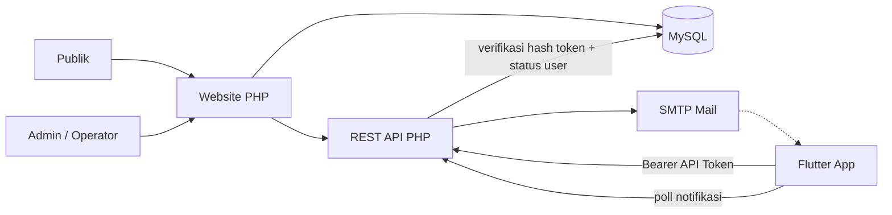

---

## D-02 Alur Autentikasi

Akun dibuat admin/operator di MySQL. Aplikasi login memakai endpoint PHP yang menerbitkan API token; backend memverifikasi hash token dan mengecek status user di MySQL.

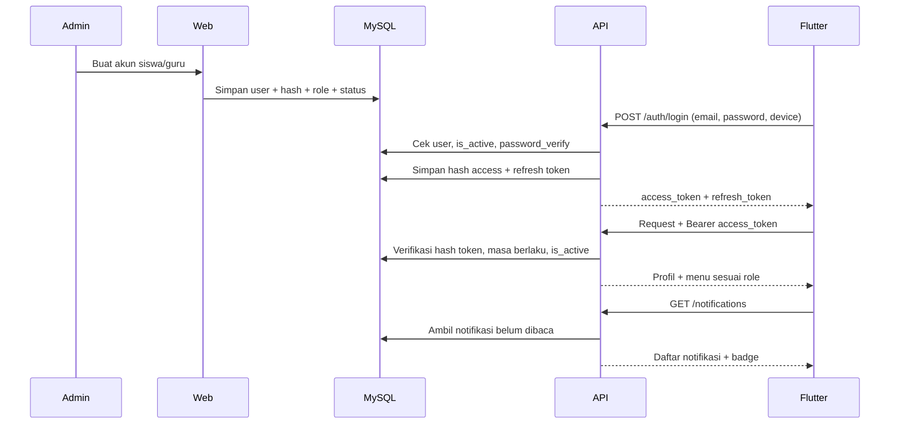

---

## D-03 Alur Presensi Guru

Guru melakukan check-in kehadiran harian atau jam mengajar. API memvalidasi role, jadwal, duplikasi, dan waktu server sebelum menyimpan presensi. Tidak ada presensi siswa atau QR siswa.

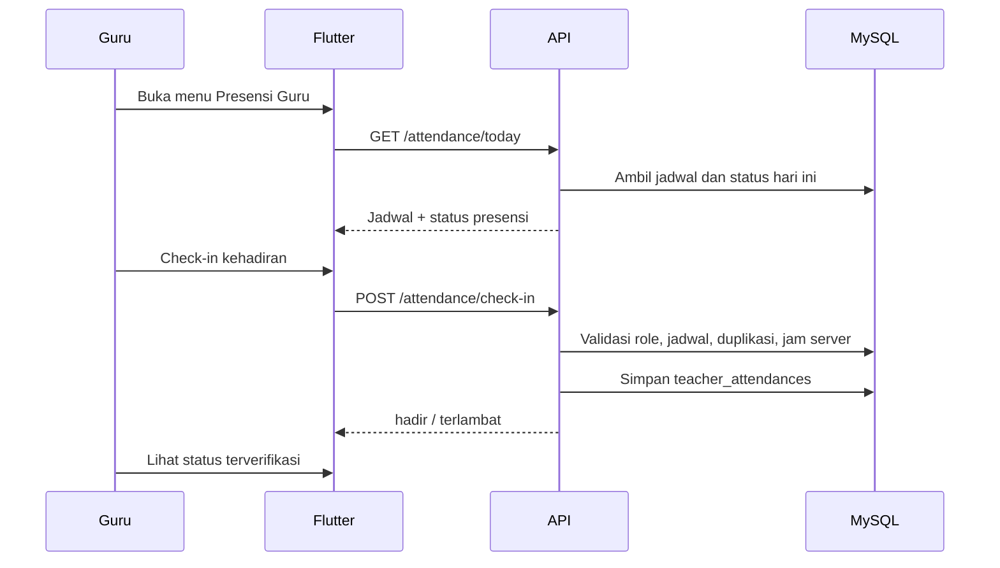

---

## D-04 Alur Akreditasi

Alur dari periode, seed IA2024, bank bukti, mapping, DKA, review, dashboard gap, sampai ekspor untuk Sispena.

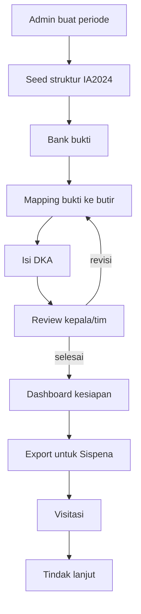

---

## D-05 Alur Info dan Dokumen PPDB

PPDB tanpa form. Publik membaca informasi dan mengunduh dokumen. Admin/operator mengelola info dan dokumen.

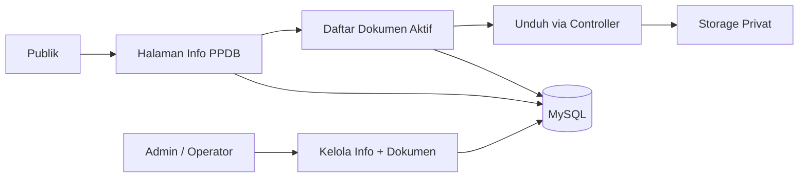

---

## D-06 ERD

ERD akademik, presensi guru, akreditasi, dan identitas. Tabel CMS (berita, galeri, fasilitas, halaman, menu, pengaturan, PPDB, kontak, media) dibahas di `10-perombakan-web.md`.

```mermaid
erDiagram
    USERS ||--o| STUDENTS : "profil siswa"
    USERS ||--o| TEACHERS : "profil guru"
    USERS ||--o{ ACTIVITY_LOGS : "aktivitas"
    USERS ||--o{ API_TOKENS : "token"
    USERS ||--o{ NOTIFICATIONS : "notifikasi"
    USERS ||--o{ PASSWORD_RESETS : "reset"

    ACADEMIC_YEARS ||--o{ CLASSES : "tahun ajaran"
    CLASSES ||--o{ STUDENTS : "anggota"
    CLASSES ||--o{ SCHEDULES : "jadwal"
    SUBJECTS ||--o{ SCHEDULES : "mapel"
    TEACHERS ||--o{ SCHEDULES : "guru"
    CLASSES ||--o{ CLASS_SUBJECTS : "kelas-mapel"
    SUBJECTS ||--o{ CLASS_SUBJECTS : "kelas-mapel"
    TEACHERS ||--o{ CLASS_SUBJECTS : "pengampu"

    CLASS_SUBJECTS ||--o{ MATERIALS : "materi"
    CLASS_SUBJECTS ||--o{ ASSIGNMENTS : "tugas"
    ASSIGNMENTS ||--o{ SUBMISSIONS : "pengumpulan"
    STUDENTS ||--o{ SUBMISSIONS : "mengumpulkan"
    TEACHERS ||--o{ SUBMISSIONS : "menilai"

    TEACHERS ||--o{ TEACHER_ATTENDANCES : "presensi"
    SCHEDULES |o--o{ TEACHER_ATTENDANCES : "jadwal mengajar"

    ACCREDITATION_PERIODS ||--o{ ACCREDITATION_COMPONENTS : "komponen"
    ACCREDITATION_COMPONENTS ||--o{ ACCREDITATION_BUTIRS : "butir"
    ACCREDITATION_BUTIRS ||--o{ ACCREDITATION_INDICATORS : "indikator"
    ACCREDITATION_BUTIRS ||--o{ DKA_ENTRIES : "DKA"
    EVIDENCE ||--o{ EVIDENCE_BUTIR : "mapping"
    ACCREDITATION_BUTIRS ||--o{ EVIDENCE_BUTIR : "bukti"
    ACCREDITATION_BUTIRS ||--o{ INDICATOR_CHECKS : "pemeriksaan"
    ACCREDITATION_INDICATORS ||--o{ INDICATOR_CHECKS : "pemeriksaan"
    ACCREDITATION_PERIODS ||--o{ EVIDENCE : "bukti"
    USERS ||--o{ EVIDENCE : "mengunggah"
    USERS ||--o{ DKA_ENTRIES : "mengisi"
    USERS ||--o{ MAIN_DOCUMENTS : "mengunggah"
    USERS ||--o{ TASKS : "ditugaskan"
    USERS ||--o{ ACCREDITATION_RESULTS : "mencatat"
    ACCREDITATION_PERIODS ||--o{ MAIN_DOCUMENTS : "dokumen utama"
    ACCREDITATION_PERIODS ||--o{ TASKS : "tugas"
    ACCREDITATION_PERIODS ||--o{ ACCREDITATION_RESULTS : "hasil"
    ACCREDITATION_RESULTS ||--o{ FOLLOW_UPS : "tindak lanjut"

    USERS {
        bigint id PK
        string name
        string email UK
        string username UK
        string password_hash
        string role
        boolean is_active
        boolean must_change_password
        datetime last_login_at
    }

    STUDENTS {
        bigint id PK
        bigint user_id FK
        string nis
        string nisn
        string gender
        date birth_date
        bigint class_id FK
        boolean is_active
    }

    TEACHERS {
        bigint id PK
        bigint user_id FK
        string nip
        string phone
        boolean is_active
    }

    ACADEMIC_YEARS {
        bigint id PK
        string name
        date start_date
        date end_date
        boolean is_active
    }

    CLASSES {
        bigint id PK
        string name
        string level
        bigint academic_year_id FK
        bigint homeroom_teacher_id FK
    }

    SUBJECTS {
        bigint id PK
        string code UK
        string name
    }

    CLASS_SUBJECTS {
        bigint id PK
        bigint class_id FK
        bigint subject_id FK
        bigint teacher_id FK
    }

    SCHEDULES {
        bigint id PK
        bigint class_subject_id FK
        tinyint day_of_week
        time start_time
        time end_time
        string room
    }

    MATERIALS {
        bigint id PK
        bigint class_subject_id FK
        string title
        text description
        string file_path
        datetime published_at
    }

    ASSIGNMENTS {
        bigint id PK
        bigint class_subject_id FK
        string title
        text description
        datetime due_at
        decimal max_score
    }

    SUBMISSIONS {
        bigint id PK
        bigint assignment_id FK
        bigint student_id FK
        string file_path
        text note
        decimal score
        text feedback
        datetime submitted_at
        datetime graded_at
        bigint graded_by FK
    }

    TEACHER_ATTENDANCES {
        bigint id PK
        bigint teacher_id FK
        bigint schedule_id FK
        date attendance_date
        string attendance_type
        datetime check_in_at
        datetime check_out_at
        string status
        string note
        bigint verified_by FK
    }

    EVIDENCE {
        bigint id PK
        bigint period_id FK
        string title
        string file_path
        string mime_type
        bigint file_size
        string checksum
        date valid_until
        string status
        bigint uploaded_by FK
        bigint verified_by FK
    }

    EVIDENCE_BUTIR {
        bigint id PK
        bigint evidence_id FK
        bigint butir_id FK
    }

    DKA_ENTRIES {
        bigint id PK
        bigint butir_id FK
        text content
        int version
        string status
        bigint updated_by FK
    }

    INDICATOR_CHECKS {
        bigint id PK
        bigint butir_id FK
        bigint indicator_id FK
        string status
        text note
    }

    ACCREDITATION_PERIODS {
        bigint id PK
        string name
        date start_date
        date end_date
        string status
        boolean is_active
    }

    ACCREDITATION_COMPONENTS {
        bigint id PK
        bigint period_id FK
        int number
        string name
    }

    ACCREDITATION_BUTIRS {
        bigint id PK
        bigint component_id FK
        int number
        text text
        string status
    }

    ACCREDITATION_INDICATORS {
        bigint id PK
        bigint butir_id FK
        int number
        text text
    }

    MAIN_DOCUMENTS {
        bigint id PK
        bigint period_id FK
        string type
        string title
        string file_path
        string status
    }

    TASKS {
        bigint id PK
        bigint period_id FK
        string title
        bigint assigned_to FK
        date due_date
        string status
    }

    ACCREDITATION_RESULTS {
        bigint id PK
        bigint period_id FK
        string grade
        decimal score
        text notes
        date decided_at
    }

    FOLLOW_UPS {
        bigint id PK
        bigint result_id FK
        text recommendation
        string status
        date due_date
    }

    ACTIVITY_LOGS {
        bigint id PK
        bigint user_id FK
        string action
        string entity
        bigint entity_id
        text metadata
        datetime created_at
    }

    API_TOKENS {
        bigint id PK
        bigint user_id FK
        string access_token_hash UK
        string refresh_token_hash UK
        string device_name
        string platform
        string ip_address
        datetime expires_at
        datetime refresh_expires_at
        datetime last_used_at
        datetime revoked_at
    }

    NOTIFICATIONS {
        bigint id PK
        bigint user_id FK
        string title
        text body
        string link
        string type
        boolean is_read
        datetime read_at
        datetime created_at
    }

    PASSWORD_RESETS {
        bigint id PK
        bigint user_id FK
        string token_hash
        datetime expires_at
        datetime used_at
    }
```

---

## D-07 Use Case

Aktor dan use case utama. Web dan aplikasi memakai data yang sama; hak akses dibatasi role.

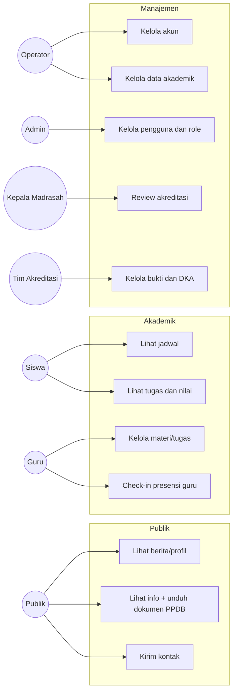

---

## D-08 Topologi Lingkungan Uji

Lingkungan lokal dan staging, termasuk web, Flutter, server SMTP, dan tools pengujian.

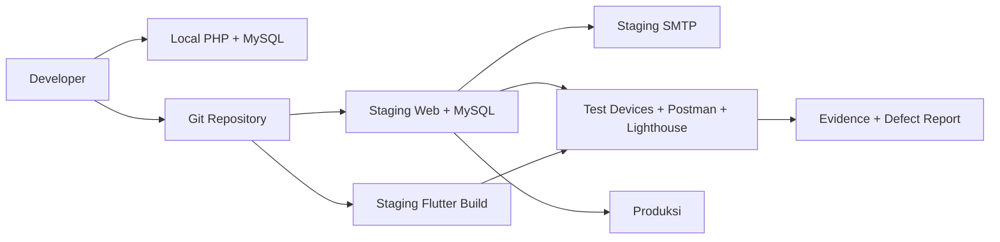

---

## D-09 Piramida Pengujian

Komposisi target: unit/component 40%, integration 35%, E2E/UAT 25%.

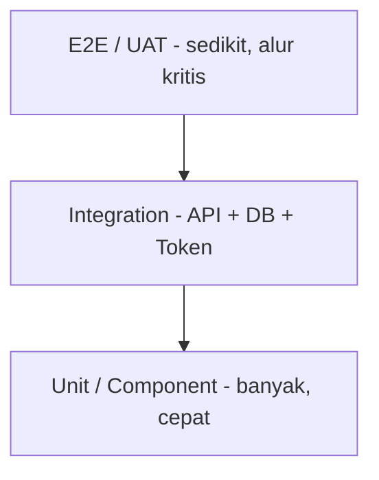

---

## D-10 Alur Bug Triage

Alur dari temuan sampai tiket ditutup, termasuk validasi dan retest.

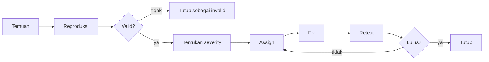

---

## D-11 Alur SDLC dan QA

Aktivitas QA mengikuti setiap fase SDLC, bukan hanya di akhir.

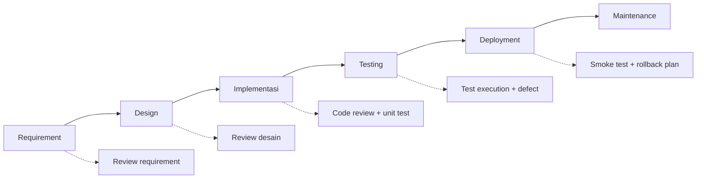

---

## D-12 Deployment dan Go-live

Alur deploy dari lokal ke staging, smoke test, UAT, produksi, dan rollback.

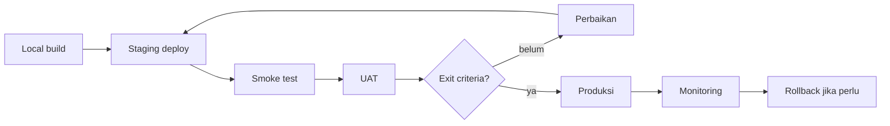

---

## Catatan konsistensi

- Nama aktor: Publik, Siswa, Guru, Operator, Admin, Kepala Madrasah, Tim Akreditasi.
- Nama sistem: Website MTs Al-Huda, Aplikasi MADRASAHKU, REST API, MySQL, API Token, SMTP.
- Tidak ada penyedia identitas eksternal (Firebase Auth, Auth0, Supabase Auth, dan sejenisnya) untuk autentikasi, dan tidak ada Firestore/Firebase Hosting/FCM.
- Satu-satunya layanan eksternal adalah SMTP untuk email transaksional; SMTP tidak menyimpan akun, role, atau hash password.
- PPDB tanpa form; hanya informasi dan dokumen unduhan.
- Setiap diagram memakai istilah dan status yang sama dengan dokumen terkait.

## Ekspor untuk laporan SQA

1. Render diagram di VS Code atau mermaid.live.
2. Ekspor PNG 300 dpi atau SVG.
3. Simpan di `diagrams/export/` dengan nama `D-XX-nama.png`.
4. Masukkan ke dokumen SQA dan perbarui daftar gambar.
